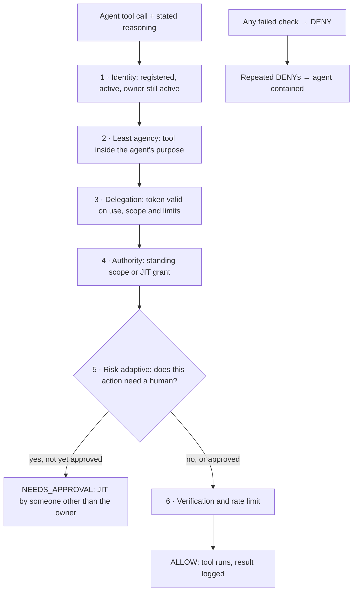

# AgentGuard — treating AI agents as insider risk


A small, dependency-free Python reference build of the agent identity and
security architecture I've been writing about. It turns the arguments into
controls you can run, break and test.

- Article: [Agentic AI Security](https://www.linkedin.com/pulse/agentic-ai-security-piyush-deshmukh-wldpc/) (Aug 2026)
- LinkedIn posts: *Are AI agents really "going rogue"?* and *Risk-adaptive autonomy and least agency* (Nov 2026)
- Prompted by Satya Nadella on The Pragmatic Engineer (Nov 2026): treat agents as insider risk; verification is the hard part

> **Scope, honestly:** this is a personal reference build with simulated agents
> and an HMAC-signed token simulation. It is not a production system, an OAuth
> server, or a client deliverable.

## From the writing to the code

| What I argued | Where it lives | What the demo shows |
|---|---|---|
| **Registry and ownership:** every agent has a named human owner and a review obligation | `identity.py` | No active owner, no agent. An owner can't delegate authority they don't hold |
| **Delegated authorization with short-lived credentials (RFC 8693)**, tied to the originating human's consent | `delegation.py` | Erin → triage-agent → refund-agent: nested `act` claim, task-scoped, 10-minute tokens carrying her consent and a SGD 200 limit |
| **Agent-to-agent calls must not expand authority at each hop**, but must stay traceable | `delegation.py` | Child scopes must be a subset of the parent's; limits only tighten; depth capped; loops refused. A hop requesting `payments:create` is refused |
| **Revoke the human, the agent keeps working**, which most tooling misses | `policy.py`, `delegation.py` | Tokens are validated on *every use*: Erin leaves and her live token dies mid-workflow. Carol leaves and her unprovisioned agent is denied |
| **Per-call policy enforcement** | `policy.py` | Every call passes identity → purpose → delegation → authority → risk → verification → rate limit |
| **Least agency:** limit the decisions an agent may take, not just its access; purpose-bound agents | `Agent.allowed_tools` | invoice-agent is denied a ticket tool outside its purpose, even though nothing else would stop it |
| **Risk-adaptive autonomy, not "approve every action"** | `ToolSpec.approval_rule`, `irreversible`, `sensitive` | SGD 1,200 payment goes through on its own; SGD 12,400 waits for a 15-minute approval from someone other than the owner |
| **Contain the agent when behaviour leaves the boundary** | `PolicyGate._maybe_contain` | A prompt injection makes triage-agent try `grant_admin`; after three denied calls it's suspended automatically and a containment event is logged |
| **A correlated audit trail:** human → agent → policy decision → credential → downstream action | `audit.py` | Each record carries trace ID, parent span, originating human, delegation chain, token, consent, the agent's stated reasoning, decision and result. HMAC hash chain; editing one record is caught at that record |
| **Forward telemetry to the SIEM** | `siem.py` | JSON lines laid out like OCSF API Activity (class 6003), with containment as a detection finding |
| **Access review without a stable baseline; the quarterly cadence is wrong** | `certification.py` | The baseline is evidence from the log. Reviews run on schedule *or* on events: Carol's leaver event triggers a review of just her agents |
| **Inventory, including agents built outside the sanctioned path** | `unregistered_identities()` | `shadow-bot` calls the gate, is denied, and appears in the report |
| **Verification is the hard part** (Nadella) | `verifier.py` | Deleting a failing test is blocked; a critic from the same model family is rejected as not independent; commits need an approved verdict |

## How a call is decided

Every tool call passes through the gate. Checks run in this order and the
first failure decides; every outcome is logged with the agent's reasoning.



Full workflows (decision tree, delegation sequence, agent lifecycle) and every
configuration option, with worked examples, are in
**[docs/OPTIONS.md](docs/OPTIONS.md)**.

## Run it

```bash
python3 demo.py                      # 9-step scenario, 4 agents in a bank ops team
python3 tests/test_agentguard.py     # 20 unit tests
```

Python 3.10+, nothing to install. Outputs land in `out/`: `audit.jsonl`,
`siem_events.jsonl`, `certification_report.md`, `triggered_review.md`.
A sample report is in [`docs/`](docs/sample_certification_report.md).

## What it deliberately doesn't do (yet)

- **Real tokens.** Delegation is an HMAC-signed simulation of RFC 8693 claims. In production the same claims come from your IdP's token-exchange endpoint, with credentials issued just in time (e.g. from Vault).
- **Real agents.** Agents are scripted. `agentguard/llm.py` shows how to plug in Claude or a local model as the cross-family critic.
- **Intent.** Identity scoping limits capability, not intent. Containment here is a simple threshold on denied calls, not behavioural analytics.
- **Egress control and network containment.** These belong in infrastructure (next step).

## Roadmap

1. Put a real Claude or local Llama agent in the loop; expose the gate as an MCP server.
2. AWS sandbox hardening: HMAC key in KMS, chain head anchored to S3 Object Lock, agent identities as IAM roles with session tags, egress through a controlled proxy.
3. Private evals: prompt-injection, reward-hacking and exfiltration scenarios scored across model families.
4. Agentic GRC: an agent collecting MAS TRM-style control evidence through the same gate.
