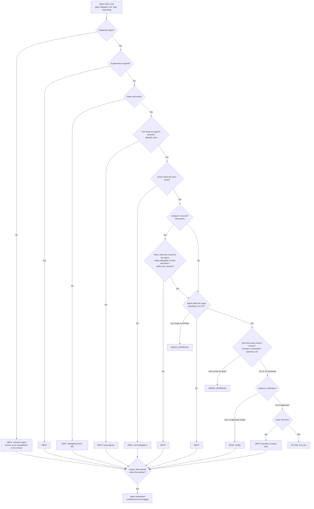
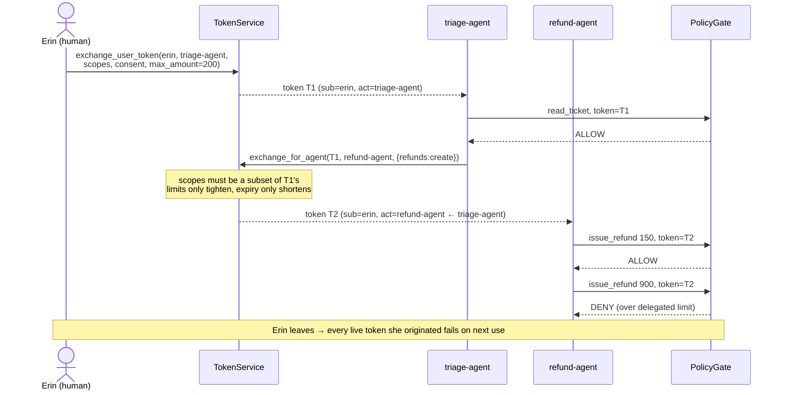
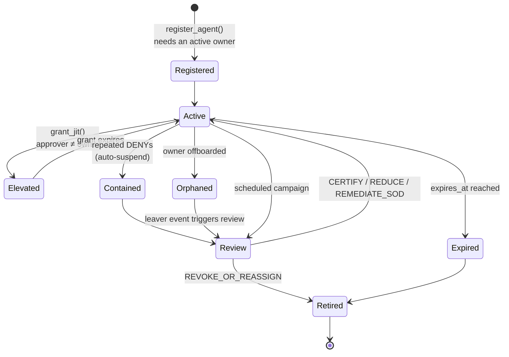

# AgentGuard — workflows and options explained

This page explains how a request moves through AgentGuard and what each
configuration option does. The [README](../README.md) has the short version.

- [1. How every tool call is decided](#1-how-every-tool-call-is-decided)
- [2. How delegation works (RFC 8693-style)](#2-how-delegation-works-rfc-8693-style)
- [3. Agent lifecycle and access review](#3-agent-lifecycle-and-access-review)
- [4. Option reference](#4-option-reference)
- [5. Choosing options: worked examples](#5-choosing-options-worked-examples)

---

## 1. How every tool call is decided

Every call an agent makes goes to `PolicyGate.call()`. The checks run in a
fixed order and the **first** one that fails decides the outcome. Every
outcome, allowed or not, is written to the tamper-evident audit log with the
agent's stated reasoning.



**The three outcomes**

| Outcome | Meaning | What happens next |
|---|---|---|
| `ALLOW` | Every check passed | The tool runs; its result is logged |
| `NEEDS_APPROVAL` | Allowed in principle, but this action needs a human | A human other than the owner calls `directory.grant_jit()`; the agent retries within the grant window |
| `DENY` | Outside the agent's authority | Logged and counted toward containment |

---

## 2. How delegation works (RFC 8693-style)

Use delegation when an agent acts **for a specific person**, not just for its
owner. The token is a delegation *envelope*: at every hop, what an agent can
actually do is the overlap of three things: what the human delegated, what
the agent itself holds, and what the human still holds right now.



**Rules the token service enforces**

| Rule | Why |
|---|---|
| Initial scopes = requested ∩ the human's entitlements | A human can't delegate what they don't hold |
| Child scopes must be a subset of the parent's | Authority never grows from one agent to the next |
| Numeric constraints only tighten (`min`) | A downstream agent can't raise the human's limit |
| Expiry = the earlier of the parent's expiry and the TTL | A child never outlives its parent |
| Chain depth capped (`max_depth`); loops refused | Bounds transitive authority |
| Validated on **every use**: signature, expiry, revocation of any ancestor, human still active, every agent in the chain still registered, unsuspended and owned | Revoking the human revokes the whole chain immediately |

---

## 3. Agent lifecycle and access review



**Review recommendations** (first match wins, in this order)

| Recommendation | Triggered when | Reviewer action |
|---|---|---|
| `REVOKE_OR_REASSIGN` | Owner is inactive | Retire the agent or assign a new accountable owner |
| `CONTAINED` | The gate suspended it | Investigate inputs and prompts before reinstating |
| `REMEDIATE_SOD` | Holds both sides of a segregation-of-duties pair | Split the agent by purpose |
| `REDUCE` | Has scopes it never used in the review window | Remove the unused scopes |
| `CERTIFY` | Every scope is evidenced by actual use; owner active | Certify |

Extra flags are added to the rationale: repeated denied calls, which humans
it acted for, and expiry within 14 days. Identities that called the gate
without being registered are listed separately.

**Two ways to run a review**

| Mode | How | Use it for |
|---|---|---|
| Scheduled | `run_campaign(directory, audit, tool_scopes)` | The periodic baseline |
| Event-triggered | `run_campaign(..., agent_ids=directory.offboard_human(user))` | Reviewing just the affected agents the moment something changes |

---

## 4. Option reference

### `Agent` — the agent's identity record

| Option | Default | What it does |
|---|---|---|
| `agent_id` | required | Unique identity name |
| `purpose` | required | Plain-language purpose, shown in reviews |
| `owner_id` | required | Accountable human. Must be active, and must hold every scope given to the agent |
| `model` | required | Model name. Used to check that a verifier is from a different model family |
| `scopes` | empty | Standing permissions. Keep small; never put sensitive scopes here |
| `allowed_tools` | empty = not purpose-bound | **Least agency.** The only tools this agent may call, whatever its scopes |
| `expires_at` | 90 days | Identity stops working after this |
| `jit_grants` | empty | Filled by `grant_jit()`; time-limited elevations |
| `suspended` | `False` | Set by containment; blocks all calls |

### `ToolSpec` — how a tool is protected

| Option | Default | What it does | Use for |
|---|---|---|---|
| `name` | required | Tool name the agent calls | |
| `scope` | required | Permission needed to call it | |
| `sensitive` | `False` | Always needs a live JIT grant; never a standing scope | PII export, admin grants |
| `irreversible` | `False` | Always needs a live JIT grant | Approving payments, deleting data |
| `approval_rule` | `None` | Function of the call's arguments; returns a reason when *this* call needs a human | Thresholds, e.g. `amount_over(5000)` |
| `requires_verification` | `False` | Needs an approved `Verdict` from `verify()` | Code commits, config changes |
| `max_per_minute` | `30` | Per-agent rate limit | Runaway-loop protection |

`sensitive`, `irreversible` and `approval_rule` are the **risk-adaptive
autonomy** controls: everything else runs without a human.

### `PolicyGate`

| Option | Default | What it does |
|---|---|---|
| `tokens` | `None` | A `TokenService`; needed to accept delegation tokens |
| `contain_after` | `3` | Denied calls that trigger automatic suspension |
| `contain_window_min` | `10` | Window, in minutes, for counting those denials |

`gate.call()` arguments: `agent_id`, `tool`, `args`, `reasoning` (required;
logged before the tool runs), and optionally `token`, `verdict`, `trace_id`,
`parent_span` (pass the previous result's `span_id` to link steps of one workflow).

### `TokenService`

| Option | Default | What it does |
|---|---|---|
| `key` | required | Signing key. In production: KMS/HSM, not in code |
| `audit` | `None` | If given, every issued token is logged |
| `ttl_minutes` | `10` | Token lifetime |
| `max_depth` | `3` | Longest allowed agent chain |

`exchange_user_token(subject, agent, scopes, consent, constraints, trace_id)`
starts a chain; `exchange_for_agent(parent, next_agent, scopes, tighten)`
extends it; `revoke(token_id)` kills a token and everything below it.

### `Directory.grant_jit()`

| Argument | Default | What it does |
|---|---|---|
| `agent_id`, `scope` | required | What is being elevated |
| `approver_id` | required | Must be an active human **other than the owner** |
| `reason` | required | Logged justification, e.g. a ticket number |
| `minutes` | `30` | Grant lifetime |

### `verify()` — the independent verifier

| Argument | What it does |
|---|---|
| `changes` | List of `Change(path, old, new)`; `new=None` means deleted |
| `producer_model` | Model that made the change |
| `critic`, `critic_model` | Optional second-opinion model. Rejected if it's from the same family as the producer |

Always blocks: deleted test files, removed assertions, newly skipped tests,
added `assert True`.

### `AuditLog` and SIEM export

| Item | What it does |
|---|---|
| `AuditLog(path, key)` | Append-only, HMAC hash-chained log |
| `audit.verify()` | Returns the first broken record and why (edited, removed or reordered) |
| `export_jsonl(audit, path)` | Writes OCSF-style events: tool calls as API Activity, containment as a detection finding, tokens as authentication events |

---

## 5. Choosing options: worked examples

**A payments agent that should run small payments on its own**

```python
Agent("invoice-agent", "Match invoices and raise payments", owner_id="alice",
      model="claude-sonnet", scopes={"payments:create"},
      allowed_tools={"create_payment"})
ToolSpec("create_payment", "payments:create", approval_rule=amount_over(5000))
```

Under SGD 5,000 it proceeds alone; above that it gets `NEEDS_APPROVAL` until
someone other than Alice grants JIT access.

**An agent acting for a customer-service user, handing off to a refund agent**

```python
t1 = tokens.exchange_user_token("erin", "triage-agent",
        {"tickets:read", "refunds:create"},
        consent="Resolve T-2044; refund if valid", constraints={"max_amount": 200})
t2 = tokens.exchange_for_agent(t1, "refund-agent", {"refunds:create"})
gate.call("refund-agent", "issue_refund", {"amount": 150}, "Duplicate charge", token=t2)
```

**A coding agent whose commits must be independently checked**

```python
ToolSpec("commit_code", "code:write", requires_verification=True)
v = verify(changes, producer_model="llama-3-70b", critic=claude_critic, critic_model="claude-sonnet")
gate.call("release-agent", "commit_code", {...}, "Fix build", verdict=v)
```

**Quick guide**

| If the action is… | Use |
|---|---|
| Routine and reversible | A standing scope only |
| Fine at low value, risky at high value | `approval_rule` |
| Irreversible | `irreversible=True` |
| Exposes sensitive data or grants access | `sensitive=True` (JIT-only) |
| Produces code or config | `requires_verification=True` |
| Done for a specific person | A delegation token |
